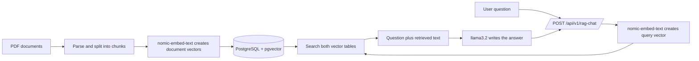

# RAG Ollama: Implementation and Knowledge Transfer Guide

This guide explains how this Spring Boot application answers questions using local Ollama models, PDF documents, and PostgreSQL with pgvector. It is written for someone who needs to run, understand, maintain, or extend the project.

## 1. What the application does

The application has two different AI models, each with a separate job:

- **`llama3.2`** reads the question and writes the answer.
- **`nomic-embed-text`** turns PDF text and user questions into vectors (arrays of numbers) so the application can find text with a similar meaning.

The vector search is the retrieval part of RAG. The application adds the retrieved text to the prompt sent to `llama3.2`.



## 2. Services and ports

| Service | Local address | Purpose |
| --- | --- | --- |
| Spring Boot application | `http://localhost:8080` | HTTP API |
| Ollama | `http://localhost:11434` | Chat and embedding model API |
| PostgreSQL with pgvector | `localhost:5433` from the app; `5432` inside its container | Vector tables and ingestion history |

This configuration assumes that Spring Boot runs directly on the host. If you put Spring Boot in Docker too, `localhost` inside the app container means that same app container. Use the Ollama and PostgreSQL service names on a shared Docker network instead, such as `http://ollama:11434` and `pgvector:5432`.

## 3. Prerequisites

- Java 21
- Docker Desktop or another Docker Engine
- The Maven wrapper included in this project
- The `rag-ollama` project folder, which contains `pom.xml` and `mvnw.cmd`

The current POM uses Spring Boot `4.1.1`, LangChain4j core and Ollama `1.22.0`, and some integration modules at `1.21.0-beta31`. Keep related LangChain4j modules aligned when upgrading; mixing versions can cause compatibility problems.

## 4. Start Ollama and download the models

Run this only if the `ollama` container does not already exist:

```powershell
docker run -d --name ollama --restart unless-stopped -p 11434:11434 -v ollama:/root/.ollama ollama/ollama:latest
```

Download both models into the Ollama data volume:

```powershell
docker exec -it ollama ollama pull llama3.2
docker exec -it ollama ollama pull nomic-embed-text
```

They are separate models. `llama3.2` generates chat answers; `nomic-embed-text` generates vectors. Pulling one does not install the other. The named `ollama` volume preserves the downloaded models if the container is restarted.

Check which models Ollama has:

```powershell
docker exec -it ollama ollama list
```

If the container already exists but is stopped, start it with `docker start ollama` instead of creating a second container.

## 5. Start PostgreSQL with pgvector

The Java configuration connects to database `vectordb` on host port `5433`, with username and password `postgres`.

Run this only if a suitable PostgreSQL/pgvector container is not already running:

```powershell
docker run -d --name pgvector --restart unless-stopped -e POSTGRES_DB=vectordb -e POSTGRES_USER=postgres -e POSTGRES_PASSWORD=postgres -p 5433:5432 -v pgvector_data:/var/lib/postgresql/data pgvector/pgvector:pg17
```

Enable the extension and create the ingestion tracking table once per database:

```powershell
docker exec -it pgvector psql -U postgres -d vectordb -c "CREATE EXTENSION IF NOT EXISTS vector;"
docker exec -it pgvector psql -U postgres -d vectordb -c "CREATE TABLE IF NOT EXISTS ingestion_log (file_name TEXT PRIMARY KEY, ingested_at TIMESTAMPTZ NOT NULL DEFAULT now());"
```

The two vector tables are created by `PgVectorEmbeddingStore` because the code sets `.createTable(true)`. The application does **not** create `ingestion_log`; the SQL above creates it. PostgreSQL stores the data in the named `pgvector_data` volume.

> The credentials in this guide match the local development defaults in the code. Do not reuse sample passwords for a shared or production database.

## 6. Configure the application

The defaults are in `src/main/resources/application.properties`:

```properties
chat-model.baseUrl=http://localhost:11434
spring.datasource.url=${DB_URL:jdbc:postgresql://localhost:5433/vectordb}
spring.datasource.username=${DB_USERNAME:postgres}
spring.datasource.password=${DB_PASSWORD:postgres}
```

`EmbeddingStoreConfig` currently has its own PostgreSQL host, port, database, username, and password in Java code. Changing `DB_URL`, `DB_USERNAME`, or `DB_PASSWORD` changes the Spring `JdbcTemplate` connection used for `ingestion_log`, but it does not change the pgvector store connection. For another environment, externalize both connections or change the pgvector configuration too.

## 7. How the Java implementation fits together

### 7.1 Chat model

`ChatModelConfig` creates the `ChatModel` bean. It points to Ollama, selects `llama3.2`, and sets a five-minute request timeout with retries disabled. The longer timeout accommodates a slow first response while Ollama loads the model.

### 7.2 Embedding model

`EmbeddingModelConfig` creates one `OllamaEmbeddingModel` bean using `nomic-embed-text`. The same bean is used for document ingestion, automatic retrieval, and the product/vaccine tools. Using the same embedding model for both stored text and search questions is essential.

### 7.3 Vector stores

`EmbeddingStoreConfig` creates two pgvector tables:

- `baby_product_embedding` stores chunks from the baby product PDF.
- `vaccine_embedding` stores chunks from the vaccine PDF.

Each store uses `embeddingModel.dimension()` to create a vector column with the right size. `createTable(true)` creates a missing table; it does not change the dimension of a table that already exists.

### 7.4 Document ingestion

`DocumentIngestionService` runs `ingestAll()` during application startup:

1. It checks `ingestion_log` for the PDF filename.
2. It loads the PDF from `src/main/resources/docs` using PDFBox.
3. It splits the document into chunks of 500 with 50 units of overlap.
4. It adds source metadata, including filename and a hash of the PDF.
5. `EmbeddingStoreIngestor` embeds each chunk with `nomic-embed-text` and saves it in the associated vector table.
6. It records the filename in `ingestion_log`.

The current files are `baby_products_catalog_100.pdf` and `vaccine_dummy_catalog_200.pdf`.

### 7.5 Retrieval

`RagRetrievalPipelineConfig` creates one retriever for each vector table. `DefaultQueryRouter` sends every question to both retrievers. Each returns up to three matches whose score is at least `0.5`; the retrieval augmentor adds the matches to the prompt before chat generation.

This is automatic retrieval. It does not depend on the model choosing a tool call.

### 7.6 Assistant, memory, tools, and API

- `BabyAssistant` is the LangChain4j AI service. Its `@AiService` names the chat model, memory provider, retrieval augmentor, and optional tools.
- `ChatMemoryConfig` keeps up to 20 recent messages per `userId`. This is in-memory only and resets when the app stops.
- `BabyProductTool` and `VaccineTool` offer additional searches that the chat model can call as tools. The `userId` is used for chat memory; current vector retrieval is shared across users.
- `BabyAssistantController` handles `POST /api/v1/rag-chat` and returns JSON with a `response` field.
- `SimpleChatController` handles `/api/v1/simple-chat`; it calls the chat model directly and **does not run the RAG pipeline**.

## 8. Run the application

Open PowerShell in the project folder (the folder containing `pom.xml`) and run:

```powershell
.\mvnw.cmd spring-boot:run
```

Start PostgreSQL and Ollama before starting Spring Boot. Ingestion happens at application startup, so both services and the database extension/tracking table must be ready first.

## 9. Call the RAG API

In PowerShell, use `curl.exe` so the command uses curl rather than PowerShell's `curl` alias:

```powershell
curl.exe --location "http://localhost:8080/api/v1/rag-chat" `
  --header "Content-Type: application/json" `
  --data '{"userId":"123","message":"Which baby products are recommended for 6+ months old?"}'
```

The body has two fields:

- `userId` identifies the caller's chat-memory session.
- `message` is the question.

Expected response shape:

```json
{
  "response": "..."
}
```

## 10. Verify that the documents were indexed

Look at the Spring Boot startup logs. For each PDF, a successful first ingestion logs `Ingested <filename>`. Also check the database:

```powershell
docker exec -it pgvector psql -U postgres -d vectordb -c "SELECT COUNT(*) FROM baby_product_embedding;"
docker exec -it pgvector psql -U postgres -d vectordb -c "SELECT COUNT(*) FROM vaccine_embedding;"
docker exec -it pgvector psql -U postgres -d vectordb -c "SELECT * FROM ingestion_log;"
```

The vector table counts should be greater than zero after successful ingestion. The exact number depends on the PDFs and splitter.

To check Ollama's container logs:

```powershell
docker logs --tail 200 ollama
```

## 11. Troubleshooting guide

### The answer is generic and ignores the catalog

1. Check startup logs for `Ingested ...`, `Document already ingested ...`, or `Exception occurred During document ingestion`.
2. Check that the vector tables contain rows and that `ingestion_log` contains both PDF filenames.
3. Check that `nomic-embed-text` is installed with `docker exec -it ollama ollama list`.
4. Temporarily lower `.minScore(0.5)` in both retrievers to `.minScore(0.0)` to see whether the score cutoff is excluding matches. Restore and tune the threshold after inspection.
5. Enable/log retrieved segment text and scores during debugging. A chat response alone does not show whether retrieval returned context.

### The model or PDF was changed, but search still returns old or irrelevant content

The current ingestion guard checks only the filename in `ingestion_log`. Although the PDF hash is added to segment metadata, the guard does not compare that hash, and it does not record the embedding-model name. Therefore, editing a PDF or switching embedding models does not automatically rebuild that file's vectors.

All vectors in a table must come from the same embedding model used for query vectors. For a local development database, clear/rebuild the affected vector rows and ingestion tracking entries, then restart the app to ingest again. For a long-lived database, track both the source hash and embedding-model version and re-index when either changes. Do not reuse vectors from a different embedding model just because their dimensions happen to match.

### The application starts but document ingestion failed

The ingestion code catches exceptions and logs them instead of stopping startup. The chat endpoint can therefore remain available even when the knowledge base is empty. Check the full Spring Boot log for `Exception occurred During document ingestion`, database errors, missing PDFs, or Ollama errors. A production implementation should expose ingestion status or fail startup when initial indexing is required but fails.

### Pgvector reports a vector dimension error

The vector dimension must match the embedding model. `createTable(true)` does not migrate an existing table to a new dimension. Rebuild the table and its vectors when changing to a model with a different dimension.

### Ollama chat requests time out

The chat builder currently sets `.timeout(Duration.ofMinutes(5))` and `.maxRetries(0)`. If requests still time out, check `docker logs --tail 200 ollama`, test Ollama directly, and account for the first request loading the model or slow CPU inference.

### The in-stock product tool returns no products

In the current `BabyProductTool`, `getInStockProducts` compares the entire text chunk to the exact text `in stock`. Catalog chunks usually contain more text, so this filter can remove every match. Search the chunk contents for the stock status or return the chunks and let the assistant interpret them.

## 12. Adding another knowledge base

Use this checklist when adding another PDF category, such as a feeding guide:

1. Add the PDF under `src/main/resources/docs`.
2. Create a dedicated pgvector table and a qualified `EmbeddingStore<TextSegment>` bean.
3. Add that PDF and store to the ingestion service.
4. Create an `EmbeddingStoreContentRetriever` using the same embedding model and the new store.
5. Add the retriever to the query router, or use a router that selects the right knowledge base by query/category.
6. Add tool methods only if you need explicit tool operations; automatic RAG and tools solve related but different jobs.
7. Start the app and verify the new ingestion log entry and vector row count.
8. Ask a question whose answer is present in the new PDF and inspect the retrieved chunks while tuning `maxResults` and `minScore`.

For per-user/private documents, add a metadata filter or separate store per user. The current `userId` separates chat memory only; it does not isolate vector search results.

## 13. Quick handoff checklist

Before handing the service to another developer, share or verify:

- The Java version and Maven command.
- The Ollama model names and how to pull them.
- PostgreSQL database name, port, credentials, and pgvector extension setup.
- Which PDFs are indexed and which vector table belongs to each.
- The importance of using the same embedding model for ingest and search.
- The current one-time ingestion behavior and how to rebuild after PDF/model changes.
- The distinction between `/rag-chat` and `/simple-chat`.
- Whether user documents are shared or isolated; this implementation shares vector stores.
- The startup logs and SQL counts that confirm ingestion succeeded.

## 14. Reference links

- [LangChain4j Ollama chat integration](https://docs.langchain4j.dev/integrations/language-models/ollama/)
- [LangChain4j Ollama embedding integration](https://docs.langchain4j.dev/integrations/embedding-models/ollama/)
- [LangChain4j pgvector integration](https://docs.langchain4j.dev/integrations/embedding-stores/pgvector/)
- [Ollama `llama3.2` model](https://ollama.com/library/llama3.2)
- [Ollama `nomic-embed-text` model](https://ollama.com/library/nomic-embed-text)
- [pgvector setup and SQL reference](https://github.com/pgvector/pgvector)
